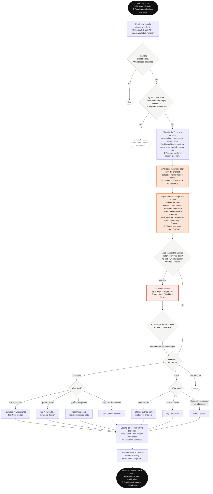

# Redcon Tender Planning – build plan

Goal: turn the HTML prototype (`index.html`) into a real, shared web app for the **4 planning engineers**, built on the company's **Microsoft 365**, on a setup that costs **$0 a month** – plus a small bill for the AI that reads the tender emails (**about $1 to about $40 a month**, depending on the AI model you choose; section 4).

With 4 users nothing comes close to any free limit, so the setup is kept as small as possible: one database service, one free web host, and the company's own Outlook mailbox and OneDrive / SharePoint.

Free limits checked November 2026 against the providers' pricing pages.

---

## 1. The setup

```
 Microsoft 365 (already paid for)
 ┌───────────────────────────────────────────┐
 │ Outlook – tenders mailbox                 │      every hour: fetch new tender emails,
 │ OneDrive / SharePoint – tenders folder    │◄──┐  send reminder emails (Microsoft Graph)
 │ Microsoft sign-in for the 4 users         │   │
 └───────────────────────────────────────────┘   │        ┌──────────────────────────────┐
                                                 │        │ AI (Claude) reads each email │
                                                 ├───────►│ and returns what it means:   │
                                                 │        │ new / update / postponed /   │
                                                 │        │ queries answers, date, links │
                                                 │        └──────────────────────────────┘
 Web app (Cloudflare Pages, free) ◄──────► Supabase (free)
 • the board you approved                    • database
 • sign in with Microsoft                    • sign-in check (only the 4 users)
 • upload files straight to SharePoint       • live updates between users
 • installs like an app → notifications      • hourly mail job + 5-minute reminder job
```

| Piece | Service | Cost | Why it is enough for 4 people |
|---|---|---|---|
| Sign-in | **Microsoft account** (your work login) through Supabase | $0 | Only your company's 4 listed users can enter |
| Database, live updates, scheduled jobs | **Supabase** Free | $0 | 500 MB database = many years of tenders |
| Reading the tenders mailbox every hour | Small Supabase function using **Microsoft Graph** | $0 | A few dozen emails a day |
| Understanding each email (Arabic) | **AI – Claude** through the Anthropic API | **~$1 to ~$40 a month** – see section 4 | Pay per email read; only tender emails are sent to it |
| Reminder emails | Sent **from the tenders mailbox** through Microsoft Graph | $0 | A handful a day; no extra email service |
| Folders and uploads | **SharePoint / OneDrive** tenders folder | $0 (in your M365) | Files stay in your Microsoft storage, not in the database |
| Desktop / browser notifications | Web Push, built into browsers | $0 | No limit |
| Web app hosting | **Cloudflare Pages** | $0 | Updates automatically from GitHub |
| Backups | Weekly copy to a private **GitHub** repository | $0 | The free Supabase plan has no backups of its own |
| Own web address (optional) | e.g. `planning.redcon.com` | ~$10–15 a year, or $0 with `….pages.dev` | – |
| Optional extra | Reminders also posted in a **Teams** chat or channel | $0 | Uses Teams' built-in Workflows |

**Running costs:** the AI email reading (section 4). Everything else is free; Supabase Pro ($25 a month) only if you later want its built-in daily backups – not needed for 4 people.

**The one free-plan rule to know:** a free Supabase project pauses after 7 days with no activity. The hourly mail check counts as activity, so in normal use it never pauses. If it ever does, restoring is one click and no data is lost.

---

## 2. What I need from you

1. **The tenders mailbox address** – the one that receives the "ورد الينا" emails (a shared mailbox or a person's mailbox) – and **where replies are sent from**: the same tenders mailbox, or each engineer's own mailbox? (If their own, their Sent folders are read too.)
2. **Where the tenders folder lives** – a SharePoint site's document library (best for a team) or someone's OneDrive – and its link.
3. **The 4 users' names and work emails**, and who is admin.
4. **5–10 real emails** ("ورد الينا", postponements, query answers), personal details blanked out, to tune the email reader.
5. **Who your Microsoft 365 admin is** – they need to do the steps in section 3 once (about 20 minutes).
6. **An Anthropic account** for the AI (console.anthropic.com, pay as you go with a company card and a monthly spending limit) – or, if the company prefers one Microsoft bill, Claude through **Microsoft Foundry** on your Azure subscription at the same prices.
7. **Which AI model** – section 4.

---

## 3. One-time setup by your Microsoft 365 admin (free)

Done in the Microsoft Entra admin centre and Exchange; I will provide exact click-by-click steps.

1. **Register an app** called "Redcon Tender Planning" (free, no licence needed).
2. **Sign-in for users:** allow the app to sign users in with their work accounts (redirect address: the app's web address).
3. **Permissions, approved by the admin:**
   - read mail (Inbox and Sent) and send mail – **limited to the tenders mailbox**, plus the 4 engineers' mailboxes only if replies go out from them (an Exchange access policy, so the app can never read anyone else's email);
   - read and write files – for the tenders SharePoint site / folder.
4. **Create a client secret** and paste it into Supabase's secret settings (never into the web page). Secrets expire – the admin picks 12 or 24 months, and the app shows a warning a month before expiry.

Until this is done, the board works and projects can be added by hand; email reading and file uploads switch on once it is approved.

---

## 4. AI email reading

Instead of fixed keyword rules, an AI model reads each email the way a person would – in Arabic, whatever the wording – works out which project it belongs to, and fills in a fixed form. The app then applies that form to the board.

Two things it never relies on:
- **The subject line alone.** Subjects that mention a project name are written differently every time (shortened, misspelt, a forward of a forward, two projects in one thread). The body is always read, and the project is found by **closest match**, not by exact name.
- **Only incoming mail.** What the team **sends** matters too – queries sent to the client, an offer submitted, an extension requested – so the **Sent** folder is read as well.

### How it works

1. **Every hour** the mail function fetches new emails from the tenders mailbox's **Inbox and Sent** folders (and, if the engineers reply from their own mailboxes, their Sent folders too – section 2).
2. **A cheap first filter** (no AI) skips emails that clearly are not about tenders – newsletters, automatic replies, calendar invitations. Everything else goes to the AI, which keeps the cost down.
3. **Shortlist of likely projects (no AI, free):** the app compares the email with every open project – project name, client, supervisor, dates, links – after evening out Arabic spelling (أ/إ/ا, ة/ه, ى/ي, Arabic digits, extra words such as "مشروع" or "أعمال"), and picks the **8 closest** with a similarity score. If the email is a reply in a conversation already linked to a project, that project goes to the top of the list as a strong hint – but the body is still read.
4. **The AI reads the whole body** together with the shortlist (name, client, supervisor, submission date, last update of each) and answers in a fixed JSON form (Claude's *structured outputs*, so the answer always has exactly these fields):

   | Field | Example |
   |---|---|
   | `direction` | `received` or `sent` |
   | `kind` | received: `new_project`, `update`, `postponed`, `queries_answers` · sent: `queries_sent`, `offer_submitted`, `extension_requested`, `reply_or_follow_up` · either: `not_a_tender` |
   | `matched_project` | the board project it belongs to, or `new` |
   | `match_reason` | "Body names the same water tank for the Water Authority, 5000 m³; subject is shortened" |
   | `other_possible_projects` | up to 2 runners-up, used when a person has to choose |
   | `project_name`, `client` | إنشاء مبنى إداري بالمنطقة الصناعية · هيئة المجتمعات العمرانية |
   | `submission_date` and the sentence it came from | 2026-12-27 – "وتم تعديل آخر موعد للتقديم ليصبح ٢٧/١٢/٢٠٢٦" |
   | `tender_type` | public / private / unknown |
   | `supervisor_first_name` | from "والمشرف علي الدراسه :" → مينا |
   | `links` | every link, with a short label (specs, BOQ, addendum…) |
   | `suggested_status` | e.g. "Queries sent to client – waiting for answers" (for sent emails) |
   | `summary` | one line for the card's update log, e.g. "Annex 2 issued – submission moved to 27 Dec" |
   | `confidence` | high / medium / low – for the match and for the facts |

5. **The app – not the AI – changes the board**:
   - received: creates the project in Unassigned, or updates it – tags, submission date (recorded in the date history as "from email"), links;
   - sent: updates the status (e.g. "Queries sent"), adds the **Submitted** tag when the offer has gone out, records extension requests;
   - every email: a line in the card's update log, marked ↓ received or ↑ sent, with a link to the original email.
6. **Anything uncertain goes to "Needs review"** instead of the board: a match the AI is not sure about (shown with its top 3 candidates – one click picks the right one, or "new project"), low confidence on a date, a date in the past, or two projects that fit equally well. Every choice a person makes there is remembered and given to the AI as an example next time, so matching improves with use.

### Flow

The full page with all three charts (email to board, daily work and reminders, tools and how they connect) is `flowchart.html`.



### Safeguards

- The AI only fills in the form; it cannot change anything by itself, and every value is checked (dates must be real dates, the project must exist, etc.).
- The original email is kept and linked from the update log, so any change can be traced back.
- Text inside an email is treated as data, never as instructions – an email saying "ignore your rules" changes nothing.
- The Anthropic key lives in Supabase's secret settings, never in the web page, with a monthly spending limit set in the Anthropic console.
- If the AI service is down, emails wait and are read on the next hourly run; nothing is lost.

### Model choice and monthly cost

Estimated for **~45 emails a day** (~30 received + ~15 sent, about 1,350 a month), each ~4,000 tokens (word pieces) in – the email plus the shortlist – and a short answer out. Prices from Anthropic's price list, November 2026.

| Model | Price per million tokens (in / out) | About per email | **About per month** | When to pick it |
|---|---|---|---|---|
| **Claude Opus 5.5** (recommended) | $4 / $20 | ~2–3 cents | **~$25–40** | Most reliable on Arabic wording, messy forwards and judging which project an email belongs to |
| **Claude Haiku 5.5** | $0.10 / $0.50 | under 0.1 cent | **~$1** | Cheapest; very likely fine for clear, standard emails – more items may land in "Needs review" |

Halve either figure by using Anthropic's batch mode (results within the hour instead of seconds), which suits an hourly job. Fewer emails a day means a proportionally smaller bill.

**How we decide:** in phase 2 both models read your 5–10 sample emails plus a few dozen more from the mailbox history, and we compare their answers with what a person would fill in. You then choose based on the results and the cost – switching later is one setting.

### Later, optional

- Read PDF attachments (e.g. an addendum that only states the new date inside the PDF).
- A short daily summary for the team: "3 new tenders, 1 postponed, 2 query answers".

---

## 5. What is simplified for 4 users

| In the prototype | In the real app |
|---|---|
| Invite engineers by email, invitation status, resend | **Admin adds the 4 people** by name + work email; they sign in with their Microsoft account. No invitation emails. |
| Choice of Google Drive or OneDrive | **SharePoint / OneDrive only** |
| Separate email-sending service | Reminders sent **from the tenders mailbox** |
| "Preview as engineer", Reset demo | Removed |

Everything else stays as approved: board, columns per engineer in your order, Unassigned, drag to assign, sorting, search bar with filters, cards with submission date and update log, project page and tabs, tender team, reminders.

---

## 6. Data

| Table | Holds |
|---|---|
| `people` | The 4 planning engineers: name, email, admin or not, colour, board order |
| `tender_team` | Tender engineers: name, Arabic first name (for reading emails), public / private |
| `projects` | Title, client, type, tender engineer, supervisor first name, assigned engineer, position, status, received date, **submission date**, SharePoint folder, last update time and by whom |
| `date_changes` | Every submission-date change: old → new, from email or by whom, when |
| `mail_events` | The card's update log; each email's Outlook id (never processed twice), received or sent, its conversation id, the AI's answer, match reason and confidence |
| `match_examples` | Choices people made in "Needs review", given to the AI as examples so matching improves |
| `review_queue` | Emails the AI was unsure about, waiting for a person to accept or correct |
| `tags`, `project_tags`, `subtasks`, `links`, `comments`, `files` | As in the prototype |
| `reminders`, `push_subscriptions` | Reminders and each person's browsers that accept notifications |
| `settings` | Mail keyword, tenders mailbox, main tenders folder, secret expiry date |

Access: only the 4 listed work emails can sign in. Microsoft keys stay on the server side, never in the web page.

---

## 7. Phases

Estimated for one developer, part-time. Usable after phase 1.

**Phase 0 – Collect and set up (1–2 days, mostly waiting for IT)**
Answers to section 2; admin does section 3; create the free Supabase and Cloudflare accounts.

**Phase 1 – The shared board (1–1.5 weeks)**
- Move the prototype into a small project (Vite + plain JavaScript), keeping its design and code.
- Database tables; "Sign in with Microsoft" for the 4 users.
- Board, cards, sorting, search and filters, project page, tags, sub-tasks, links, comments, submission date with history – all on real data, updating live on everyone's screen.
- Team panel: add / order / edit the 4 people; tender team editor.
- Publish on Cloudflare Pages.

**Phase 2 – Hourly email reading with AI (1–1.5 weeks)**
- Runs every hour and on the "Sync email" button; fetches only new emails from the tenders mailbox.
- Inbox and Sent; first filter; shortlist of closest projects; the AI reads each body, picks the closest match and fills in the form (section 4); the app applies it: new project, update, postponement with new date, queries answers, queries sent, offer submitted, supervisor's first name, links, update-log line.
- Test set: your sample emails plus a few dozen from the mailbox history, with the correct answers written down; both AI models are measured on it before switching on, and again whenever the instructions change.
- "Needs review" list in the app for anything uncertain.
- Each email is processed once and given an Outlook category ("Tender Planning") so you can see what was read.

**Phase 3 – SharePoint folders and files (3–4 days)**
Create or link a project folder inside the tenders folder; upload from the Uploads tab straight to SharePoint (large drawings included); the Files tab lists the folder's contents with links to open them.

**Phase 4 – Reminders (3–4 days)**
- Checked every 5 minutes: desktop / browser notification, plus an email from the tenders mailbox when chosen (optionally a Teams message).
- Automatic reminders 3 days and 1 day before each submission date.
- "Install app" so notifications arrive when it is closed (works in Edge and Chrome; on iPhone: Add to Home Screen, iOS 16.4+).

**Phase 5 – Launch (2–3 days)**
Import current tenders, weekly GitHub backup, short walkthrough with the 4 users, then two weeks of fixes from real use.

**Total: about 3.5–4.5 weeks part-time**, plus however long the IT approval takes.

---

## 8. Risks

| Risk | Handling |
|---|---|
| IT approval takes time | The board is usable with manual entry meanwhile; email and files switch on after approval |
| App secret expires (12–24 months) | Expiry date stored; the app warns the admin a month ahead; renewing takes 5 minutes |
| Free project pauses after 7 idle days | Hourly mail check keeps it active; one-click restore, no data lost |
| No built-in backups on the free plan | Weekly automatic backup to GitHub |
| An email matched to the wrong project | Shortlist + AI reason + confidence; unsure matches go to "Needs review" with the top 3 candidates; a wrong match can be moved to the right project in one click from the update log |
| AI misreads an email | It only fills a form; values are checked; uncertain cases go to "Needs review"; every change is traceable to its email |
| AI cost grows | Only filtered tender emails are sent; monthly spending limit in the Anthropic console; batch mode halves the price |
| AI service unavailable | Emails wait for the next hourly run; nothing is lost |
| iPhone notifications | Need the app on the home screen; email (or Teams) reminders as backup |
